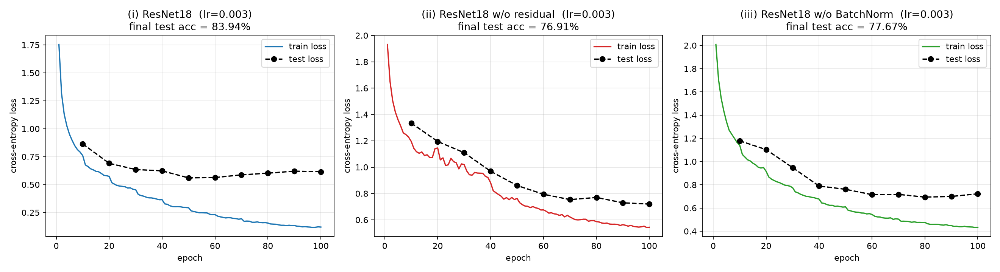
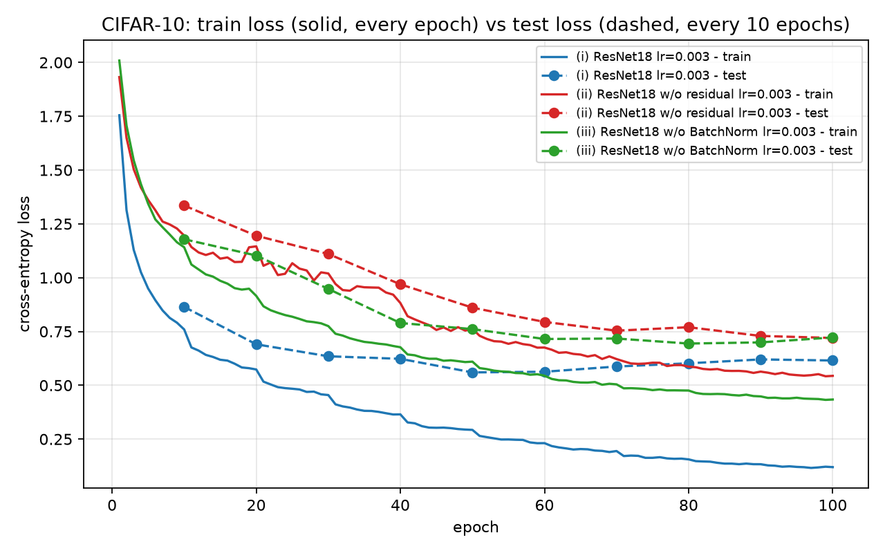

# 4. Deep Residual Networks for CIFAR-10

**Interfaces used:** PyTorch 2.x on an Apple M2 GPU (`mps` backend), NumPy, matplotlib. No `torchvision.datasets` or `torchvision.transforms` are used.

**Code** (`ResNet/`):

| file | role |
|---|---|
| `DataReader.py` | part (a) |
| `ImageUtils.py` | part (b) |
| `Model.py` | part (c) |
| `NetWork.py` | the model and its variants (part (d)) |
| `main.py` | trains and evaluates one run |
| `report.py` | tables and figures |

To reproduce:
```bash
python main.py --variant {resnet18|no_residual|no_batchnorm} --lr {0.003|0.01|0.03}
python report.py
```

## (a) Data loading: `DataReader.load_data`

- Uses the CIFAR-10 "python version" (`cifar-10-batches-py`).
- Each of `data_batch_1…5` and `test_batch` is a pickled dict. `b'data'` is a `uint8 [10000, 3072]` array (1024 red, then 1024 green, then 1024 blue values per row); `b'labels'` holds the labels.
- The five training batches are concatenated into `x_train [50000, 3072]` (float32) and `y_train [50000]` (int32). The test batch gives `x_test [10000, 3072]` and `y_test [10000]`.
- `train_vaild_split` keeps the first 45,000 images for training and the last 5,000 for validation. Validation is used to choose the learning rate.

## (b) Data augmentation: `ImageUtils.preprocess_image` (NumPy, one image at a time)

1. **Random crop.** Zero-pad 4 pixels on each side (32×32 → 40×40), then crop a random 32×32 window: the top-left corner is drawn uniformly from {0,…,8}².
2. **Random horizontal flip** with probability 0.5.
3. **Per-channel normalization.** For each of the 3 channels, subtract that channel's mean over the 32×32 pixels and divide by its standard deviation. A floor of 1e-6 guards against a constant channel.

Steps 1–2 apply only in training mode. Normalization is applied to every image, at training and test time.

## (c) Training and testing pipeline: `Model.py`

**Training** (`Cifar.train`):
- Each epoch shuffles the 45k training images and splits them into batches of 128.
- Each batch goes through `parse_record` (augmentation and normalization), then a forward pass, cross-entropy loss, `zero_grad` → `backward` → `Adam.step`.
- **lr schedule:** `StepLR(step_size=10, gamma=1/1.5)`, so the learning rate is divided by 1.5 every 10 epochs.
- **Logging:** the mean training loss is recorded every epoch. Every 10 epochs the model is evaluated (in eval mode, without augmentation) on the validation and test sets, and the loss and accuracy are recorded.
- **Checkpoints:** saved every 10 epochs.

**Testing** (`Cifar.test_or_validate`): loads a checkpoint and reports its accuracy on the given set.

**Resume option:** I also added `--resume`. Every 10 epochs it saves the full training state (weights, Adam state, scheduler, random-number state), so a run that crashes continues from that point. A resumed run reproduces the uninterrupted run exactly; the epoch-2 loss matched to 6 decimals. I needed this because NumPy occasionally crashed with a segmentation fault on the local machine.

## (d) Comparing the three models

**The three variants** (selected with `--variant`):

| variant | change from ResNet18 |
|---|---|
| (i) **ResNet18** | none: standard BasicBlock ResNet18 with residual connections and BatchNorm |
| (ii) **no residual connections** | each block returns `relu(bn2(conv2(relu(bn1(conv1(x))))))` without adding `x`; the 1×1 projection shortcuts are removed as well, so the network is a plain 18-layer CNN |
| (iii) **no BatchNorm** | every BatchNorm layer (stem, blocks and shortcut projections) is replaced by `nn.Identity`; residual connections are kept |

**Hyper-parameters:**
- 100 epochs, Adam, batch size 128, weight decay 2e-4 (the code base default).
- Learning rate divided by 1.5 every 10 epochs.
- Learning rate tuned over {0.003, 0.01, 0.03} using **validation accuracy at epoch 100**.
- Seed 0 for every run.

| model | lr | final train loss | val acc | test acc |
|---|---|---|---|---|
| (i) ResNet18 | **0.003** | 0.120 | **83.56%** | 83.94% |
| (i) ResNet18 | 0.01 | 0.350 | 81.02% | 80.78% |
| (i) ResNet18 | 0.03 | 0.747 | 72.30% | 70.96% |
| (ii) w/o residual | **0.003** | 0.544 | **77.26%** | 76.91% |
| (ii) w/o residual | 0.01 | 0.671 | 74.38% | 73.53% |
| (ii) w/o residual | 0.03 | 1.625 | 13.88% | 13.08% (fails to train) |
| (iii) w/o BatchNorm | **0.003** | 0.434 | **78.78%** | 77.67% |
| (iii) w/o BatchNorm | 0.01 | diverged (peak 5.4×10⁶) | 9.50% | 10.00% (chance) |
| (iii) w/o BatchNorm | 0.03 | diverged (peak 1.2×10¹¹) | 9.50% | 10.00% (chance) |

**The best learning rate is 0.003 for all three models.**

## (e) Results with the best hyper-parameters

| model | best lr | final test loss | **final test accuracy** |
|---|---|---|---|
| (i) ResNet18 | 0.003 | 0.615 | **83.94%** |
| (ii) ResNet18 w/o residual connections | 0.003 | 0.720 | **76.91%** |
| (iii) ResNet18 w/o BatchNorm | 0.003 | 0.722 | **77.67%** |




The figures show training loss every epoch (solid) and test loss every 10 epochs (dashed).

### Observations

1. **Full ResNet18 is clearly best.** It is about 6–7 points more accurate than either ablation, and it trains fastest. After 10 epochs its test accuracy is 71.3%, against 55.5% (no residual) and 61.1% (no BN). It also reaches by far the lowest training loss, 0.12 versus 0.54 and 0.43. Both components make the 18-layer network much easier to optimize.

2. **Without residual connections, optimization is the bottleneck.** The plain network has the highest training loss of the three throughout training, and its training curve is the noisiest during the first 40 epochs. That is the "degradation" problem from He et al.: the shortcut gives gradients a direct path through the network, and without it the 18-layer stack is harder to train even with BatchNorm. Its test loss stays close to its training loss, so the plain network underfits rather than overfits.

3. **Without BatchNorm, the usable learning rates shrink.** At lr 0.003 the model trains reasonably well, reaching 77.7%, slightly above the plain network. At lr 0.01 and 0.03, however, the loss explodes in the first epochs (to about 5×10⁶ and 10¹¹) and the network never recovers: it predicts a single class (10% accuracy, loss stuck at ln 10 ≈ 2.303). BatchNorm keeps activation scales under control and smooths the loss landscape (Ioffe & Szegedy), which is what allows larger steps. The full ResNet18 still trains at lr 0.03, reaching 71%.

4. **Every model gets worse as the learning rate grows.** For full ResNet18, test accuracy falls from 83.9% to 80.8% to 71.0% as lr goes 0.003 → 0.01 → 0.03. Adam's default-scale learning rates (~1e-3) suit this network best; with a schedule that only divides by 1.5 every 10 epochs, the larger learning rates are still fairly high at epoch 100 (0.03 / 1.5⁹ ≈ 7.8e-4).

5. **Full ResNet18 overfits after about epoch 50.** Its test loss reaches its minimum of 0.56 at epochs 50–60, then rises slightly to 0.62 while training loss keeps falling (0.29 → 0.12). Test *accuracy* still creeps up (82.1% → 83.9%). The model becomes over-confident on the images it gets wrong, which raises the cross-entropy while barely changing the argmax. The two ablated models have smaller train–test gaps because they fit the training set less well.

6. **The absolute accuracy (~84%) is limited by the architecture.** This ResNet18 keeps the ImageNet-style stem: a 7×7 convolution with stride 2 followed by a 3×3 max-pool. On 32×32 inputs that shrinks the feature map to 8×8 before the first residual stage. A CIFAR-style stem (3×3 convolution with stride 1, no max-pool) typically reaches over 93%. This does not change the comparison, since all three models share the same stem.
